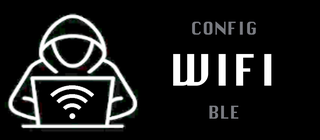
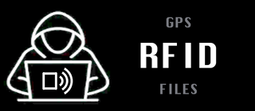
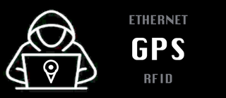
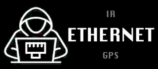

# 🖥️ Black Hack — Bruce Theme

<p align="center">🇺🇸 <a href="README.md">English</a> · 🇫🇷 <b>Français</b></p>

[](https://github.com/BruceDevices/firmware) [](https://github.com/BruceDevices/firmware) [](LICENSE)

Un thème UI **hacker** minimaliste pour le firmware **[Bruce](https://github.com/BruceDevices/firmware)**. Un personnage encapuchonné est assis devant un portable à gauche ; l'icône de l'entrée de menu **courante** apparaît comme un sticker au dos de l'écran du portable. À droite, un menu texte vertical épuré : l'entrée courante en **gros blanc** (police carrée), l'entrée **précédente** au-dessus et la **suivante** en dessous, plus petites et grises.

## 🎛️ Rendu

| WiFi | RFID | GPS | Ethernet |
|:---:|:---:|:---:|:---:|
|  |  |  |  |

Le libellé est **intégré dans l'image** (`label: 0`, `border: 0`), donc rien ne se chevauche :

- 🏷️ Seule l'icône **courante** est affichée, centrée sur l'écran du portable.
- 🔠 Colonne de droite, de haut en bas : **précédent** (petit, gris) · **COURANT** (gros, blanc, police carrée) · **suivant** (petit, gris).
- ⚙️ 16 pictos dessinés à la main : WiFi, BLE, RF, NRF24, LoRa, IR, Ethernet, GPS, RFID, Files, Scripts, Clock, Others, Config (+ FM & Connect).

## 📦 Contenu

`Black_Hack/` contient **4 tailles** (une par gabarit d'écran Bruce), chacune avec **16 PNG** + son `.json` :

| Dossier | Image | Écran cible |
|---|---|---|
| `105px/` | 240×105 | M5StickC Plus (240×135) |
| `140px/` | 320×140 | **T-Embed CC1101 / Cardputer (320×170)** |
| `180px/` | 320×180 | écrans ~320×210 |
| `192px/` | 320×192 | écrans ~320×222 |

> ℹ️ **Barre d'état** — Bruce réserve **30 px en haut** (batterie / heure / WiFi). La bonne taille = **hauteur de l'écran − 30**. Pour le **T-Embed CC1101 (320×170) → `140px`**.

## 🚀 Installation

1. Copie le dossier **`Black_Hack`** à la racine de la carte SD.
2. Sur l'appareil : **Config → UI Theme → `Black_Hack/<taille>/Theme_Black_Hack.json`** (`140px` pour le T-Embed CC1101).
3. Via WiFi : **Files → WebUI**, upload le dossier, puis sélectionne le `.json`.

## 🧭 Ordre du menu (voisins)

Les libellés **précédent / suivant** sont peints dans chaque image selon l'ordre par défaut du menu Bruce sur T-Embed CC1101 :

`WiFi → BLE → RF → NRF24 → LoRa → IR → Ethernet → GPS → RFID → Files → Scripts → Clock → Others → Config` (en boucle).

## 🛠️ Régénérer

Les icônes et la mise en page sont générées par `generate_theme.py` (Python + Pillow) à partir de `fond.png`. Chaque picto est recadré à sa vraie boîte englobante et mis à l'échelle pour être centré dans l'écran du portable, sans toucher le contour blanc. Modifie les réglages en tête du script puis lance :

```bash
python3 generate_theme.py
```

## 🛒 Matériel

*Liens partenaires Amazon : si vous achetez via ces liens, le projet touche une petite commission, sans surcoût pour vous.*

<table>
<tr>
<td align="center" width="33%">
  <a href="https://www.amazon.fr/dp/B0D45MSMJR?linkCode=ll2&amp;tag=koua29bblackhackthem-21&amp;ref_=as_li_ss_tl"></a><br>
  <b><a href="https://www.amazon.fr/dp/B0D45MSMJR?linkCode=ll2&amp;tag=koua29bblackhackthem-21&amp;ref_=as_li_ss_tl">Batterie Anker 545 (10 000 mAh)</a></b><br><sub>Pour faire tourner le T-Embed loin d'une prise</sub>
</td>
<td align="center" width="33%">
  <a href="https://www.amazon.fr/dp/B0C1FCZM94?linkCode=ll2&amp;tag=koua29bblackhackthem-21&amp;ref_=as_li_ss_tl"></a><br>
  <b><a href="https://www.amazon.fr/dp/B0C1FCZM94?linkCode=ll2&amp;tag=koua29bblackhackthem-21&amp;ref_=as_li_ss_tl">Antenne SMA 433 MHz (lot de 2)</a></b><br><sub>Antenne sub-GHz pour la radio CC1101</sub>
</td>
<td align="center" width="33%">
  <a href="https://www.amazon.fr/dp/B0B7NVMBPL?linkCode=ll2&amp;tag=koua29bblackhackthem-21&amp;ref_=as_li_ss_tl"></a><br>
  <b><a href="https://www.amazon.fr/dp/B0B7NVMBPL?linkCode=ll2&amp;tag=koua29bblackhackthem-21&amp;ref_=as_li_ss_tl">microSD SanDisk 64 Go (lot de 2)</a></b><br><sub>Pour les thèmes, scripts et captures Bruce</sub>
</td>
</tr>
</table>

<sub>En tant que Partenaire Amazon, je réalise un bénéfice sur les achats remplissant les conditions requises.</sub>

## ☕ Un café ?

Si ce thème te plaît :


## 📄 Licence

MIT © koua29. Fond et pictos inclus.
